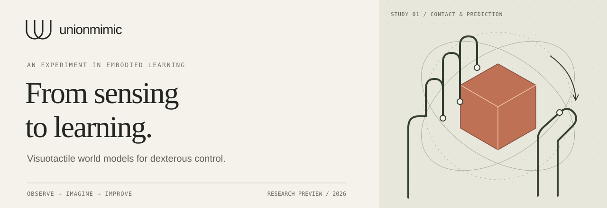

<p align="center">

当前状态（2026-11-09晚）：已交付[52秒中文Demo](work/demos/unionmimic-geometry-story-20261109-v1/unionmimic-geometry-story.mp4)及[几何先验实测](docs/GEOMETRY_AND_DEMO_BACKUP_20261109.md)。独立测试位置估计4.00→2.18 mm，尚无策略控制收益；新的4096环境SM基线运行中，最多至11月10日02:47:09上海。50Hz转笔物理验收仍未通过，原24小时窗口不变。

  
</p>

<p align="center">
  <a href="#the-idea">The idea</a> ·
  <a href="docs/MAINLINE.md">Project mainline</a> ·
  <a href="docs/INSIGHTS.md">Research insights</a> ·
  <a href="docs/ARCHITECTURE.md">Architecture</a> ·
  <a href="docs/EXPERIMENTS.md">Experiments</a> ·
  <a href="docs/GETTING_STARTED.md">Get started</a>
</p>

# UnionMimic

[Published results and demos](docs/RESULTS_RELEASE_20261109.md) · [SM/PPO validation](docs/SM_PPO_VALIDATION_20261109.md)

**SuperMimic learning with a WM-Craftnet recurrent context prior.**

**Verified scope:** SM learns sustained z-axis rotation on the Sharpa hand from an untrained actor/critic. At an early checkpoint near two hours: 40.43 rad and 7.03% failures; the last historical development evaluation recorded 1 failure in 512 episodes. A matched PPO speed comparison is now being measured; full pen adaptation and prior control benefit remain unverified. [Evidence and comparison protocol](docs/SM_PPO_VALIDATION_20261109.md).

UnionMimic keeps two model roles separate: SuperMimic's learned physical dynamics supports imagined rollouts and actor BPTT; WM-Craftnet summarizes depth, touch, proprioception and action history into additional policy context.

The implemented diagnostic task is **one Sharpa hand, one object, z-axis rotation**. The next action scope is two capability tasks and two external reference motions; their training settings are on hold pending [reference-implementation validation and Sharpa adaptation](docs/REFERENCE_BASELINE_AUDIT_20261103.md). Establish a strong SM baseline with an untrained actor and critic through [reference-code review and Sharpa adaptation experiments](docs/SM_REPRODUCTION.md), then compare that tuned baseline against SM with a frozen pretrained WSM context branch. Both arms inherit the baseline improvements. Measure control precision, rotation progress, failures and total learning cost. PPO-Sim provides a learning/cost reference.

> **Research preview · 9 November 2026**
> A frozen WM-Craftnet encoder and a small geometry readout reduce current-object position error on an independent simulation seed; random-encoder and depth-clamped controls are recorded. This is perception evidence, not improved policy control. Three earlier short context-training arms failed to learn sustained rotation. A new full-recipe SM baseline is running from scratch; the old stopped runs remain closed. Full 50 Hz pen adaptation still fails its physical gate. [Current evidence](docs/GEOMETRY_AND_DEMO_BACKUP_20261109.md) · [Demo labels and sources](docs/DEMOS.md).

## The idea

A recurrent representation can summarize contact history that a short observation stack misses. The question is whether that context improves an SM-trained policy's precision in physics.

The context must also evolve during imagination. We therefore test the consistency of context updated from real observations versus predicted observations/features. Adding context to the actor alone is not evidence that the dynamics predictor becomes more accurate.

| Estimate context | Imagine physics | Measure control |
| :--- | :--- | :--- |
| A pretrained WSM processes sensor and action history. | A separate SM model predicts physical consequences; a defined bridge updates imagined context. | Train actor/critic from scratch and compare precision and total cost in physics. |

The intended contribution is a reproducible SM-plus-context system and evidence about when context consistency helps contact-rich control. Novelty and performance gains are hypotheses, not established results.

## The pipeline

```text
Current policy → simulator → replay → fit SM physical dynamics
                                    ↓
Real history → frozen WSM → context → imagined actor/physics loop
                                    ↓
                        BPTT actor + critic updates → new policy
```

*Target architecture. Imagined context requires a validated observation/feature update. Model and critic parameters are fixed during actor updates; gradients through their inputs remain enabled. The complete new loop is not yet verified.*

[Read the architecture →](docs/ARCHITECTURE.md)

## What is established

The recorded acceptance run used a **Tesla V100-SXM2-32GB**, the released z-axis checkpoint, and one environment.

| Check | Recorded evidence |
| :--- | :--- |
| Physics & sensing | GPU physics, 72 × 96 depth, five fingertip contact channels |
| Original policy replay | 200 control steps in 36.13 seconds |
| Runtime integrity | Strict checkpoint loading; finite outputs; explicit reset passed |
| Training isolation | Policy/model parameters unchanged; all three processes exited normally |

This verifies the runtime path. It is **not** a full-episode success rate, a training-speed benchmark, or evidence that SM outperforms PPO. [Machine-readable record](docs/evidence/step1-summary.json) · [Acceptance report](docs/STATUS.md)

## Research notes

| Read | What it answers |
| :--- | :--- |
| [Mainline](docs/MAINLINE.md) | What is the accepted goal, scope and sequence? |
| [Insights](docs/INSIGHTS.md) | What can perception and differentiable control share? |
| [Architecture](docs/ARCHITECTURE.md) | Where do observations, actions and gradients go? |
| [Experiment design](docs/EXPERIMENTS.md) | How will SM and SM+prior precision and cost be compared? |
| [SM reproduction](docs/SM_REPRODUCTION.md) | What counts as successful reproduction, and what is being debugged? |
| [Current training plan](docs/ONLINE_TRAINING_PLAN.md) | What runs on each GPU, for how long, and how is it evaluated? |
| [Environment](docs/ENVIRONMENT.md) | How are dependencies, runtime isolation and W&B managed? |
| [Roadmap](docs/ROADMAP.md) | What does each stage deliver to the next? |
| [Getting started](docs/GETTING_STARTED.md) | How can the runtime check be reproduced? |
| [Website foundation](docs/WEBSITE.md) | How does the project page grow into a full website? |

## Get started

The simulation stack targets **Linux + an NVIDIA GPU**, Python 3.8, PyTorch 2.1 / CUDA 11.8, and Isaac Gym Preview 4. Bootstrap currently targets the verified V100 environment; review the prerequisites before installing elsewhere.

```bash
git clone https://github.com/LyrineYang/unionmimic.git
cd unionmimic
# Review prerequisites in docs/GETTING_STARTED.md first.
bash scripts/bootstrap.sh
bash scripts/run_step1.sh --gpu 0 --steps 200
```

The website preview needs no ML dependencies or build tools:

```bash
cd website
python3 -m http.server 8080 --bind 127.0.0.1
```

Open `http://localhost:8080` on that machine. For a remote server, see [port forwarding](docs/WEBSITE.md).

<details>
<summary>Preview the project website</summary>

The image below is a historical layout preview. Current method text follows [MAINLINE.md](docs/MAINLINE.md).


Static source: [website/](website/) · Design and publication guide: [docs/WEBSITE.md](docs/WEBSITE.md).

</details>

## Built on

- **[WM-Craftnet](https://github.com/sharpa-robotics/WM-Craftnet)** — Sharpa's task, sensors, visuotactile RSSM, and released policy. [Paper](https://arxiv.org/abs/2609.07002)
- **[SuperMimic](https://supermimic.github.io/)** — short imagined rollouts and policy optimization through learned dynamics. [Paper](https://arxiv.org/abs/2610.28480)
- **[LEAP adaptation reference](https://github.com/Msornerrrr/in-hand-rotation-mjlab/tree/0ab03eb2244b4a1a020d94ef38a4823bb9e15ba0)** — reference learner; its MuJoCo stack is not a dependency.

Exact versions and checksums: [config/upstreams.json](config/upstreams.json). UnionMimic is an independent project, not an official release of either upstream. [Attribution and reuse notes](NOTICE.md).
