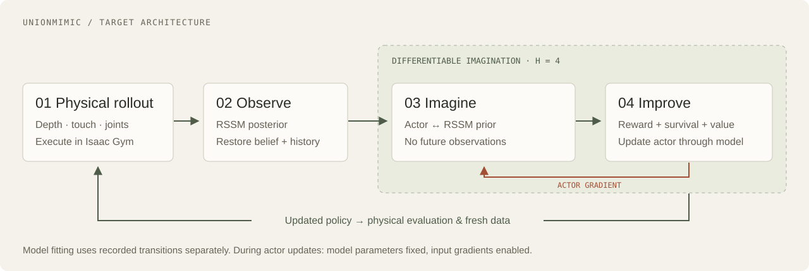
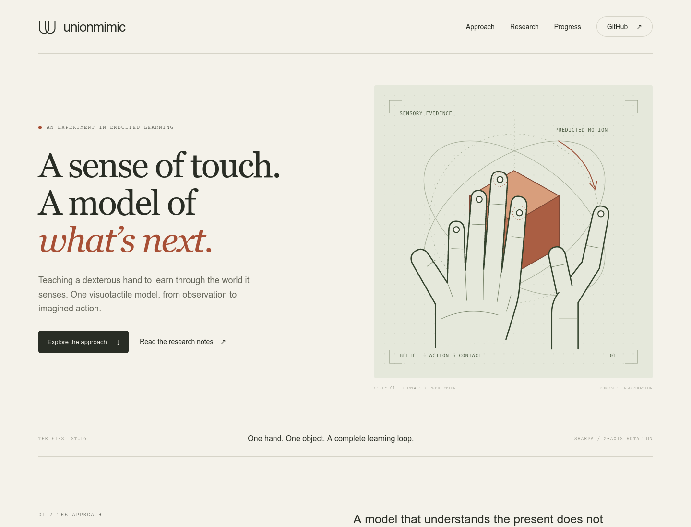

<p align="center">
  
</p>

<p align="center">
  <a href="#the-idea">The idea</a> ·
  <a href="docs/INSIGHTS.md">Research insights</a> ·
  <a href="docs/ARCHITECTURE.md">Architecture</a> ·
  <a href="docs/EXPERIMENTS.md">Experiments</a> ·
  <a href="docs/GETTING_STARTED.md">Get started</a>
</p>

# UnionMimic

**One visuotactile world model. Two capabilities: observe the present, imagine what comes next.**

UnionMimic adapts WM-Craftnet's recurrent state-space model (RSSM) for SuperMimic-style policy learning. Depth, touch, and proprioception estimate the state of a dexterous hand; short imagined rollouts are intended to carry gradients back to its policy.

The first task is concrete: **one Sharpa hand, one object, z-axis rotation**, initialized from released weights and compared with PPO fine-tuning from the same starting point.

> **Research preview · November 2026**
> The original policy and sensing stack passed a single-V100 replay check. Data collection, prediction calibration, and policy-training integration are under active development. Comparative training results are not yet established. [Evidence & status →](docs/STATUS.md)

## The idea

A useful state estimate is not automatically a useful training model. A model corrected by sensors at every step can still drift when asked to predict the future on its own.

UnionMimic makes that gap explicit. It reuses the **same RSSM** for observation updates and action-conditioned imagination, then checks whether its predictions and gradients improve control in the original physics simulator.

| Observe | Imagine | Improve |
| :--- | :--- | :--- |
| Fuse real depth, touch, and joint history into a recurrent state. | Predict a short future without access to future sensor observations. | Update the actor through model dynamics, then evaluate it in physics. |

This is an engineering adaptation and research program. The intended contribution is a working WM + SM loop with explicit sensor, action, reset, and gradient contracts—and evidence about when it helps.

## The pipeline



*Target architecture. Start with H = 4, approximately 0.4 seconds at the original control rate. Model and critic parameters are fixed during actor updates; gradients through their inputs remain enabled.*

[Read the architecture →](docs/ARCHITECTURE.md)

## What is established

The recorded acceptance run used a **Tesla V100-SXM2-32GB**, the released z-axis checkpoint, and one environment.

| Check | Recorded evidence |
| :--- | :--- |
| Physics & sensing | GPU physics, 72 × 96 depth, five fingertip contact channels |
| Original policy replay | 200 control steps in 36.13 seconds |
| Runtime integrity | Strict checkpoint loading; finite outputs; explicit reset passed |
| Training isolation | Policy/model parameters unchanged; all three processes exited normally |

This verifies the runtime path. It is **not** a full-episode success rate, a training-speed benchmark, or evidence that SM outperforms PPO. [Machine-readable record](docs/evidence/step1-summary.json) · [Acceptance report](docs/STATUS.md)

## Research notes

| Read | What it answers |
| :--- | :--- |
| [Insights](docs/INSIGHTS.md) | What can perception and differentiable control share? |
| [Architecture](docs/ARCHITECTURE.md) | Where do observations, actions and gradients go? |
| [Experiment design](docs/EXPERIMENTS.md) | How will PPO and SM be compared fairly? |
| [Roadmap](docs/ROADMAP.md) | What does each stage deliver to the next? |
| [Getting started](docs/GETTING_STARTED.md) | How can the runtime check be reproduced? |
| [Website foundation](docs/WEBSITE.md) | How does the project page grow into a full website? |

## Get started

The simulation stack targets **Linux + an NVIDIA GPU**, Python 3.8, PyTorch 2.1 / CUDA 11.8, and Isaac Gym Preview 4. Bootstrap currently targets the verified V100 environment; review the prerequisites before installing elsewhere.

```bash
git clone https://github.com/LyrineYang/unionmimic.git
cd unionmimic
# Review prerequisites in docs/GETTING_STARTED.md first.
bash scripts/bootstrap.sh
bash scripts/run_step1.sh --gpu 0 --steps 200
```

The website preview needs no ML dependencies or build tools:

```bash
cd website
python3 -m http.server 8080 --bind 127.0.0.1
```

Open `http://localhost:8080` on that machine. For a remote server, see [port forwarding](docs/WEBSITE.md).

<details>
<summary>Preview the project website</summary>



Static source: [website/](website/) · Design and publication guide: [docs/WEBSITE.md](docs/WEBSITE.md).

</details>

## Built on

- **[WM-Craftnet](https://github.com/sharpa-robotics/WM-Craftnet)** — Sharpa's task, sensors, visuotactile RSSM, and released policy. [Paper](https://arxiv.org/abs/2609.07002)
- **[SuperMimic](https://supermimic.github.io/)** — short imagined rollouts and policy optimization through learned dynamics. [Paper](https://arxiv.org/abs/2610.28480)
- **[LEAP adaptation reference](https://github.com/Msornerrrr/in-hand-rotation-mjlab/tree/0ab03eb2244b4a1a020d94ef38a4823bb9e15ba0)** — reference learner; its MuJoCo stack is not a dependency.

Exact versions and checksums: [config/upstreams.json](config/upstreams.json). UnionMimic is an independent project, not an official release of either upstream. [Attribution and reuse notes](NOTICE.md).
