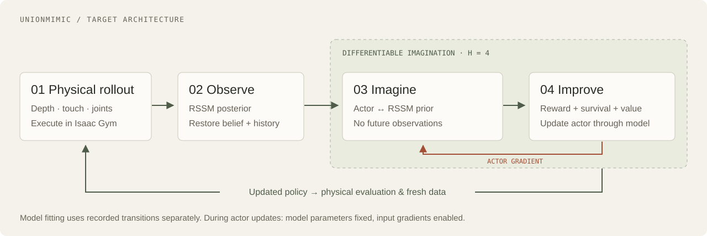

# Architecture

**Keep WM-Craftnet as the primary system. Add policy optimization through its RSSM prior.**

This is the target training loop; [status](STATUS.md) records what has passed validation.



## Physical and imagined loops

The physical loop executes the actor in Isaac Gym. Depth, binary fingertip contact, and proprioception update the RSSM posterior. Recorded transitions train the model and provide starting histories for imagination.

The imagined loop alternates actor actions and RSSM prior transitions for H = 4 steps. Predicted reward, survival and a terminal value form the actor objective. The updated actor returns to physics for evaluation and new data. Future recorded observations may supervise prediction, but must not enter the actor's imagined rollout.

| Component | Reused | Required adaptation |
| --- | --- | --- |
| Task and sensors | Sharpa assets, depth, contact, reward, resets | Aligned data and terminal-observation capture |
| World model | Encoder, `obs_step`, `img_step`, `get_feat`, released weights | State restoration; reward/failure calibration; prior validation |
| Actor | Original MLP, WSM projection, normalization | Differentiable inference and reconstructed history |
| Controller | Noise, smoothing, scaling, clipping, relative targets | Match the mapping inside imagination |
| Learner | Short-rollout and value-target ideas from the SM reference | Actor optimizer, latent critic, survival weighting, save/resume |

## State and action contract

The checked checkpoint has 22 actions. A low-dimensional observation frame has 22 joint positions, 22 joint targets, five contacts, and 24 axis-direction features. Four frames yield 292 values. A 32-dimensional RSSM projection gives the actor 324 inputs in total.

Restore the complete RSSM state (`deter`, `stoch`, `logit`), four-frame policy history, and controller memory (`prev_targets`, `last_actions`). A projected feature cannot restore recurrent dynamics. Warm up with real observation history and recompute starts after model updates.

For the inspected relative-control configuration, after command noise and clipping:

```text
executed_action[t] = 0.8 * command[t] + 0.2 * last_actions[t]
joint_target[t+1] = clip(joint_target[t] + scale[t] * executed_action[t])
```

The RSSM receives the smoothed executed action. Imagination reconstructs targets and rolls the actor history forward. Check this adapter against physical execution with identical random draws before learning through it.

## Gradients and updates

```text
J(actor) = sum[t=0..H-1] gamma^t * survival[t] * predicted_reward[t+1]
           + gamma^H * survival[H] * V(state[H])
```

1. Fit the model on recorded transitions. Start with reward/failure calibration; adjust dynamics when validation calls for it.
2. Freeze model and critic **parameters**, then differentiate through their **inputs** to update the actor. Do not wrap imagination in `no_grad`.
3. Fit the critic separately with detached targets and consistent reward scaling. Distinguish true failures from time limits for bootstrapping.
4. Evaluate in physics and refresh data. Rising imagined return alone is not improved control.

Preserve the RSSM's straight-through discrete-latent path. Freeze actor normalization statistics while retaining input gradients. The player's original inference-only path cannot be used unchanged.

## Transition contract

Store episode and step IDs; observation before action; command and executed action; controller state; next observation **before reset**; reward; failure and time-limit flags; sensor inputs; and separately identified privileged training labels. Include checkpoint/configuration identifiers, control period, seed, and source revision.

Split whole episodes into train and validation sets. Keep slips, drops, and failed recoveries. Reject corrupt or misaligned records rather than selecting only successes.

## Source map

| Pinned upstream file | Responsibility |
| --- | --- |
| `isaacgymenvs/utils/world_model.py` | Inference, replay and checkpoint integration |
| `wsm/networks.py` | RSSM observation and imagination steps |
| `wsm/models.py`, `wsm/configs.yaml` | Losses and auxiliary heads |
| `rl_games/algos_torch/network_builder.py` | Actor and feature projection |
| `isaacgymenvs/tasks/wm_craftnet_camera_rotation.py` | Physical observations, actions, rewards and resets |

See [pinned revisions](../config/upstreams.json). Load the released prop/depth checkpoint strictly, then initialize added heads explicitly. The inspected default reward-loss setting and disabled continuation head motivate calibration; they do not establish how historical weights were trained.

Original implementation details are preserved in [ADAPTATION.md](ADAPTATION.md) (Chinese).
