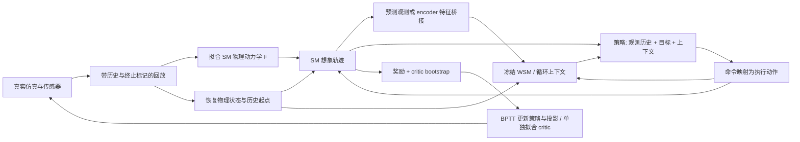

# Architecture

**11月9日晚几何分支：** `geometry_context.py`已实现冻结编码器＋位置读出，以及F预测位置＋AR(1)估计残差接口。真实读出与离线想象梯度检查已完成；尚未接入actor训练。它是可解释的几何消融，不等同于完整RSSM递推，也不改善F本身。当前Demo的读出只作观察器。[接口、实测与边界](GEOMETRY_AND_DEMO_BACKUP_20261109.md)。

**11月9日机制分支已实现：** `unionmimic/context_study.py`在相容10Hz角块上实现完整后验缓存、策略上下文投影、冻结RSSM动作prior递推及三个受控变体，复用固定LEAP更新函数。操作与接口检查通过；独立短训评估三组均失败，尚无控制收益。此分支不含50Hz残差/视觉桥接，详情见 [三阶段实验](CONTEXT_STUDY_20261109.md)。

**11月9日接口限制：** 下文为目标架构，第一版WSM权重冻结；不交替训练两个完整模型。真实编码可缓存，想象只调用必要循环分支。10Hz增量动作先验不能直接接到50Hz参考残差动作；见 [成本/必要性与接口审查](FROZEN_CONTEXT_AUDIT_20261109.md)。

**2026-11-09 重新授权：** 本次24小时窗口固定至11月10日19:44:55（上海），包括修复、验收与训练；全部验收通过后自动启动四卡SM/PPO，无需再次确认。新候选整段相位首步通过354/416（85.1%），尚未达到90%，正修复接触与重定向；长训尚未启动。[现场与计划](PEN_ADAPTATION_AND_QUEUE_20261109.md) · [可展示demo](DEMOS.md)。


**11月4日最新决定：完整Sharpa多动作适配优先。** 角块SM/PPO长训已于11:28:50停止，权重和历史评估保留，不自动恢复。50Hz、四任务物理接口与模拟位姿观测已有短测；单笔抓取未过验收，完整参考命令、学习器/想象接口仍待完成。先完成这些适配，再比较SM/PPO，之后接WM-Craftnet。[验收缺口与执行顺序](SHARPA_FULL_ADAPTATION_20261104.md)。以下日期记录属于历史快照。


**SM 是训练主体；WM-Craftnet 提供策略上下文。** 本文是目标接口，实际实现及验收状态见 [STATUS.md](STATUS.md)。目标边界见 [MAINLINE.md](MAINLINE.md)。

## 当前已实现的基线

11月3日晚已将新baseline入口切换到固定LEAP原生验证；下段`online/`为历史实现。新`sharpa_leap.py`只完成物理状态/控制器适配，已在4096环境与原版F接口检查中通过，完整参考learner上的Sharpa在线SM仍未完成。参见[最新实现边界](LEAP_NATIVE_EXECUTION_20261103.md#2317适配接口实测)。

`unionmimic/online/` 已完成独立F、当前策略回放、BPTT actor、TD(λ) critic及PPO-Sim参照；两个短试跑和实际断点续训通过。F使用177维物理/控制器状态和93维仿真上下文；actor保留四帧292维可部署观测。WSM上下文与桥接仍是下一阶段。对照复查见 [SM_BASELINE_REVIEW.md](SM_BASELINE_REVIEW.md)，运行证据见 [ONLINE_TRAINING_PLAN.md](ONLINE_TRAINING_PLAN.md)。

## 两条模型通路



图中 SM 的 F 在线学习，只在 actor 更新时固定参数；WSM 第一版始终固定参数、持续更新内部状态。桥接器如需训练，先仅接收辅助监督。未来真实传感器只可用作监督标签。

## 状态与接口

- `s_t`：SM 预测所用物理状态，含模型所需的物体/手状态及控制器记忆；`ξ` 为明确记录的仿真随机化上下文。最终字段应通过观测、reward 和终止重建对齐检查。
- `o_history,t`：actor 可部署的观测历史；`g_t` 为已知目标轴/方向。两组历史长度一致，不把已知运动目标误当未来观测。
- `x_t`：完整 WSM RSSM 状态，包括确定性与随机部分；`h_t = D(x_t)` 为传给 actor 的确定性特征，`ψ` 为可训练投影。只存 h 不能完整恢复 x。
- `y_t`：WSM 实际需要的多模态传感器输入，`e_t = Encφ(y_t)`。训练用特权标签不是 y 的隐含组成部分。

```text
真实交互:
  e_t       = Encφ(y_t)
  x_t       = Uφ(x_(t-1), u_(t-1), e_t)
  a_t       = πθ(o_history,t, g_t, ψ(D(x_t)))
  u_t       = Controller(a_t, memory_t, noise_t)
  s_(t+1)   = Simulator(s_t, u_t, ξ)

想象交互（目标接口）:
  a_hat_t   = πθ(o_hat_history,t, g_t, ψ(D(x_hat_t)))
  u_hat_t   = Controller(a_hat_t, memory_hat_t, noise_t)
  s_hat_next = Fω(s_hat_t, u_hat_t, ξ)
  e_hat_next = Bridgeη(s_hat_next, x_hat_t, u_hat_t, ξ)
  x_hat_next = Uφ(x_hat_t, u_hat_t, e_hat_next)
```

Bridge 可以是已验证的观测重建映射加冻结 encoder，或预测 encoder 特征的模块。直接把本体感觉向量送入需要深度/触觉的 WSM encoder 不满足接口。桥接状态若不足以决定观测，必须补足状态/上下文或建模相应噪声，不能假设映射精确。

桥接训练先用记录动作检验传感器/特征、状态与动作偏差，还需在 F 自由展开产生的输入上验证，以暴露训练时真实状态与想象预测状态的差异。当前桥接尚未完成实现与验收。

更简单的候选为 `x_hat_next = Priorφ(x_hat_t,u_hat_t)`。它无新观测纠正，作为候选/消融与目标接口分开报告；原有 `img_step` 可帮助验证该路线，但不能因此宣称实现了预测观测驱动的 WSM 更新。

## 优化与梯度

`J = Σ gamma^t * survival_t * r_hat_(t+1) + gamma^H * survival_H * V(s_hat_H)`。

| 更新阶段 | 更新参数 | 固定参数与注意事项 |
| --- | --- | --- |
| 真实回放拟合 | F 及其所需预测头；桥接如启用则用独立辅助损失拟合 | WSM、actor 固定；采用记录动作，不跨 episode |
| actor/BPTT | actor 与 ψ | F、WSM、桥接、critic 参数固定；仍保留对输入的导数 |
| critic | critic | 使用分离计算图的 TD(λ) 目标；失败与超时分开处理 |
| 后续 WSM 适配实验 | 明确允许的 WSM 模块 | 首先只用辅助目标，不默认引入 actor 梯度；更新后重算状态 |

actor 学习不加载发布策略，不加入靠近发布动作的 anchor。SM 和 SM+prior 使用同样的基础 actor/critic 设计；新增分支容量、初始化与计算单独记录。归一化及随机初始化规则在正式实验前固定。

## 可复用的现有契约

现有环境有22维动作。发布策略的单帧为73维、四帧292维，外加 WSM 投影；这是旧接口事实，不限定新 SM actor 必须加载旧网络。保留已核实的噪声、裁剪、滤波、相对目标累积顺序：

```text
executed_action[t] = 0.8 * clipped_noisy_command[t] + 0.2 * last_action[t]
joint_target[t+1]  = clip(joint_target[t] + scale[t] * executed_action[t])
```

回放保留命令与实际执行动作、episode/step、当前及重置前下一观测、失败/超时、控制器状态和模型版本。按完整 episode 划分数据，保留失败样本；WSM 状态从真实前缀恢复，模型更新后重算相关缓存。

历史 collector 主要记录传感器、动作与 RSSM 后验；新 `online/simulator.py` 已补齐独立F所需物理/控制器状态、随机化上下文和精度字段。跨进程恢复保留learner/replay/RNG，仿真开始新episode，不声称恢复PhysX内部接触缓存。参考代码与原架构细节在 [ADAPTATION.md](ADAPTATION.md) 中作为历史实现保存，不能替代此处两条通路的验收。

## 模块责任与验收

| 模块 | 必须交付的证据 |
| --- | --- |
| 仿真/动作适配器 | 同输入/噪声下的执行动作、控制器、reward/termination 对齐 |
| SM learner | 当前策略采集、F 持续更新、actor BPTT、critic 拟合在同一闭环；联合断点可续 |
| WSM 上下文接口 | 真实前缀恢复、每步想象更新、冻结权重与输入梯度证明 |
| 观测/特征桥接 | 固定动作和自由展开下的上下文/动作偏差、无未来观测泄漏 |
| 评估器 | 轴偏差、非目标轴运动、旋转量及失败的逐回合记录，含完整成本 |

固定参考版本见 [upstreams.json](../config/upstreams.json)。第三方 SM 手部参考不是官方 SM 实现；引用代码、方程一致和物理验收须分别说明。
