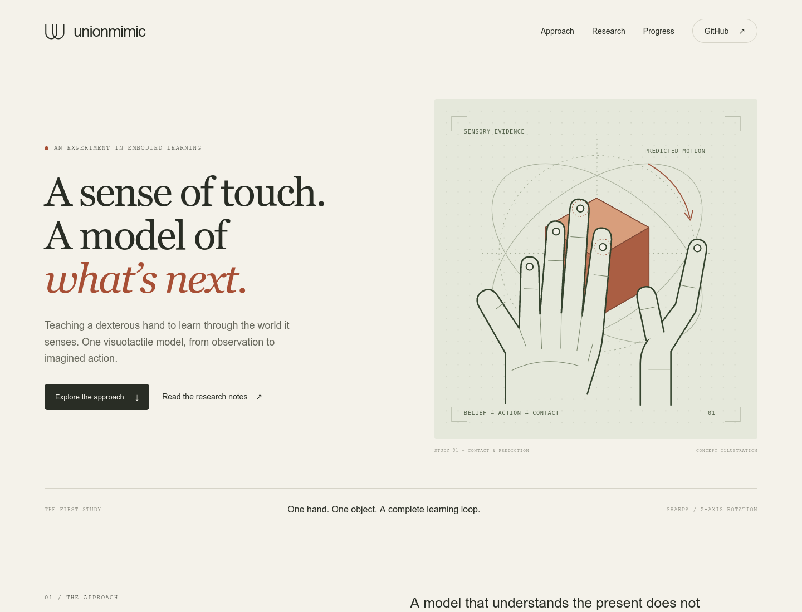

# Website foundation

The complete static preview lives in [`website/`](../website/). It is designed for later publication; no hosting, domain, analytics, or external font service is required for the local preview.



The page was rendered in Firefox at desktop and mobile sizes. Local links, SVGs, image assets, horizontal overflow on a 390px viewport, and both model-explanation controls were checked. This checks the presentation; it does not validate the training implementation.

## Preview

From the repository root:

```bash
cd website
python3 -m http.server 8080 --bind 127.0.0.1
```

Open `http://localhost:8080` on the same machine. When running on the lab server, open a second terminal **on your Mac** and use your existing SSH host alias:

```bash
ssh -N -L 8080:127.0.0.1:8080 hust_lab
```

Then open `http://localhost:8080` locally. Substitute your actual SSH alias if it differs. The server stays bound to loopback. Stop the HTTP server and tunnel with Ctrl-C when finished.

## Design direction

Warm paper, dark ink, restrained terracotta and sage, expressive serif headings, small monospace annotations, thin rules and generous space. The references are [Physical Intelligence](https://www.pi.website/) and [Anthropic](https://www.anthropic.com/), interpreted as an editorial research identity rather than copied page layouts.

| Token | Value | Purpose |
| --- | --- | --- |
| Paper | `#f4f2ea` | Page canvas |
| Ink | `#292d25` | Main text and actions |
| Muted | `#66675b` | Secondary copy |
| Sage | `#e6e9dd` | Model explanation |
| Terracotta | `#a74f35` | Accent and emphasis |
| Dark | `#30392e` | Verified evidence section |
| Display | Georgia / Times New Roman | Editorial headings |
| Body | Arial / Helvetica | Readable prose |
| Annotation | Courier New / monospace | Stage and evidence labels |

All fonts have local system fallbacks. No third-party assets or scripts are fetched. Original SVG artwork is labeled as conceptual; the depth thumbnail is real acceptance evidence. The website has no synthetic chart or pretend policy demo.

## Structure

| File | Purpose |
| --- | --- |
| `website/index.html` | Hero, approach, pipeline, research notes, evidence, progress and references |
| `website/styles.css` | Responsive layout, tokens, keyboard focus and reduced-motion support |
| `website/app.js` | Observe/Imagine explanation switch; the page remains readable without JavaScript |
| `website/assets/` | Original illustration, favicon, cover/pipeline exports and recorded depth sample |
| `docs/assets/` | GitHub README cover and pipeline source |

Navigation and document links are real. Repository links currently point to the private `LyrineYang/unionmimic` repository, so visitors need permission. The preview is not a live training dashboard.

## Prepare for a future launch

Deploy the **contents of `website/`**, not the repository root. It is buildless and uses relative asset paths, so it can run under a project subpath. `website/.nojekyll` supports plain static hosting. GitHub Pages availability for a private repository depends on the account plan; this scaffold does not assume it is enabled.

Before a public release, decide the website audience independently of repository visibility. Add a canonical URL and absolute social-preview image URL after selecting a host/domain. Keep private training artifacts and server configuration out of the deployed directory.

The next content additions should be backed by actual experiments:

1. A policy video with checkpoint identity, task conditions and playback speed.
2. PPO/SM curves from matched runs with seeds, budgets and raw measurements.
3. Prediction-versus-simulator examples, including contact switches and failures.
4. A release page with reproducible commands and downloadable, licensed artifacts.

Update README, [STATUS.md](STATUS.md), and website status text together when new evidence is accepted. The cover and pipeline are copied into `website/assets/` for self-contained deployment; keep those copies byte-identical to `docs/assets/`.
